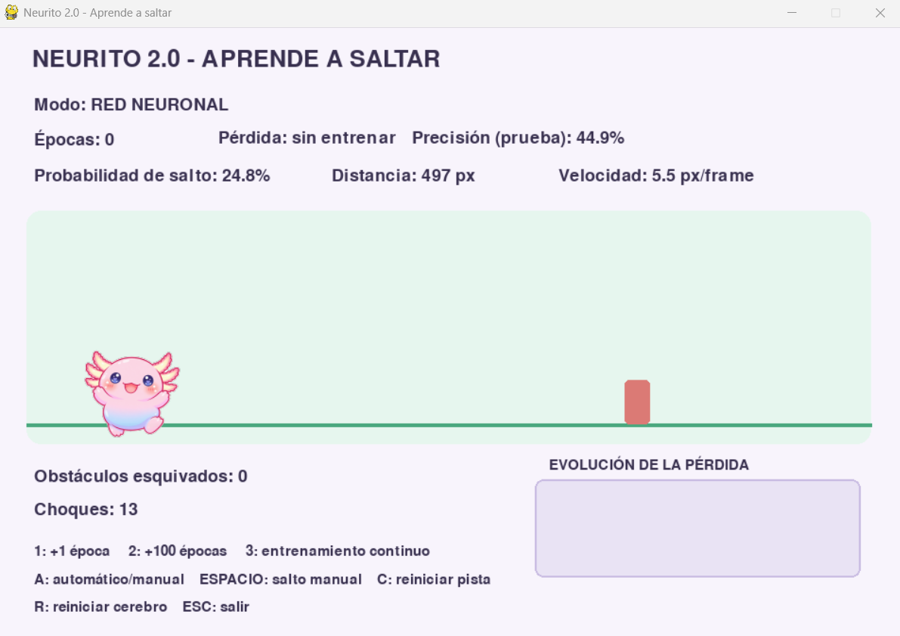
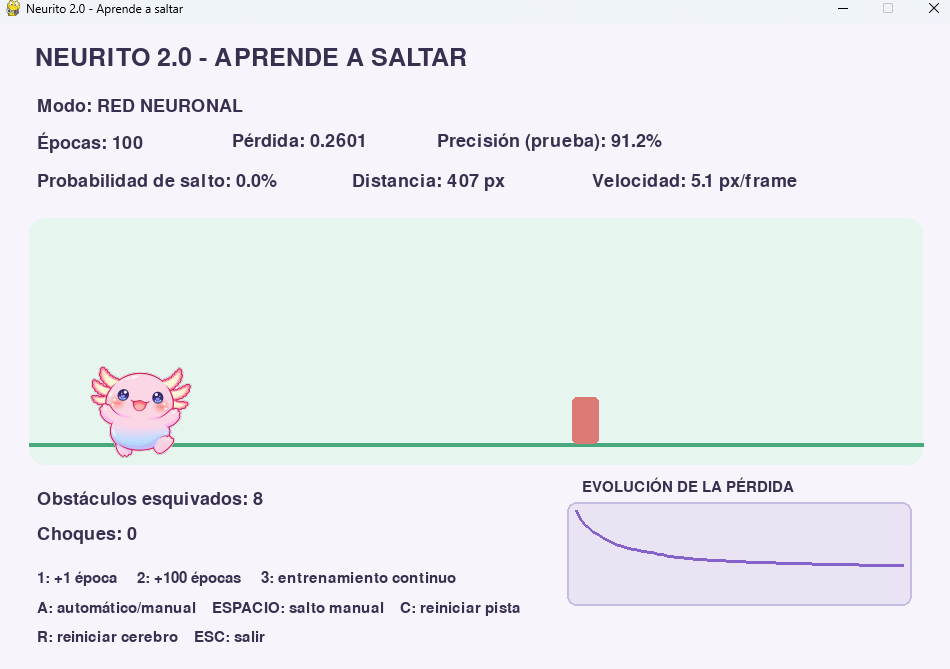
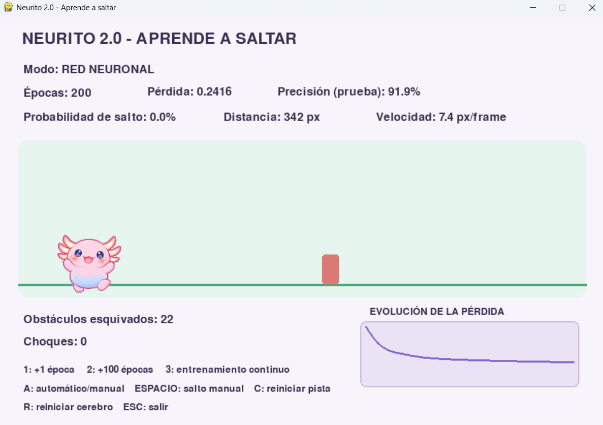
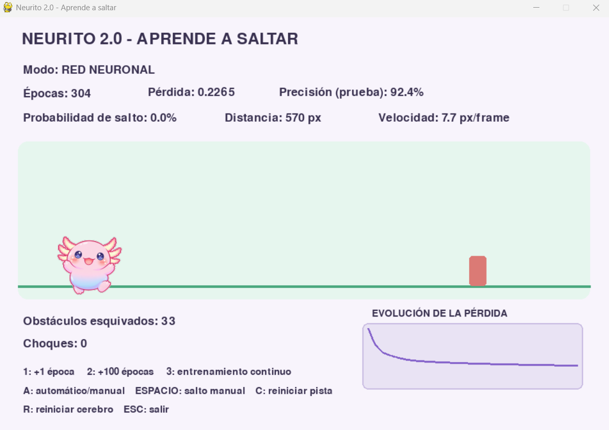
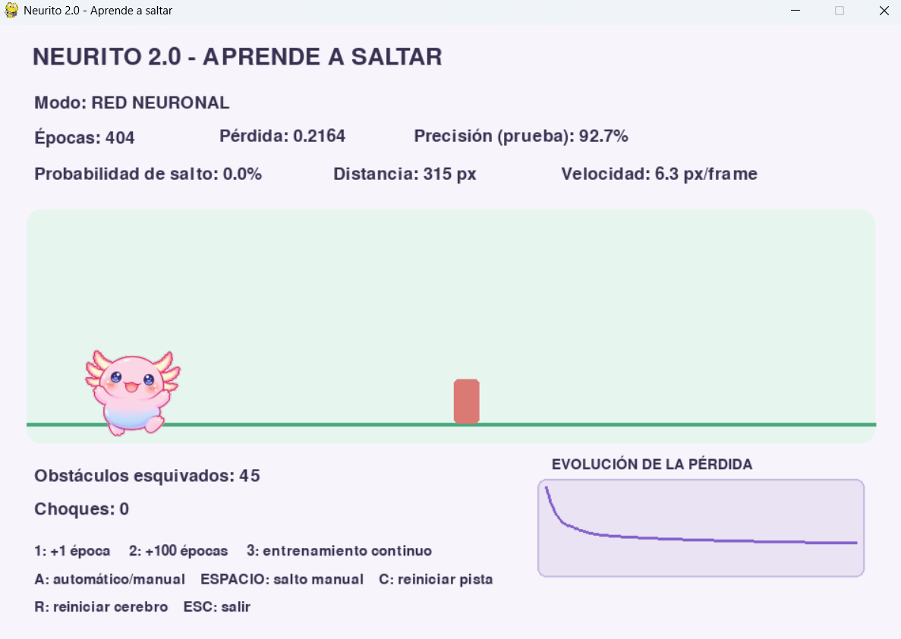
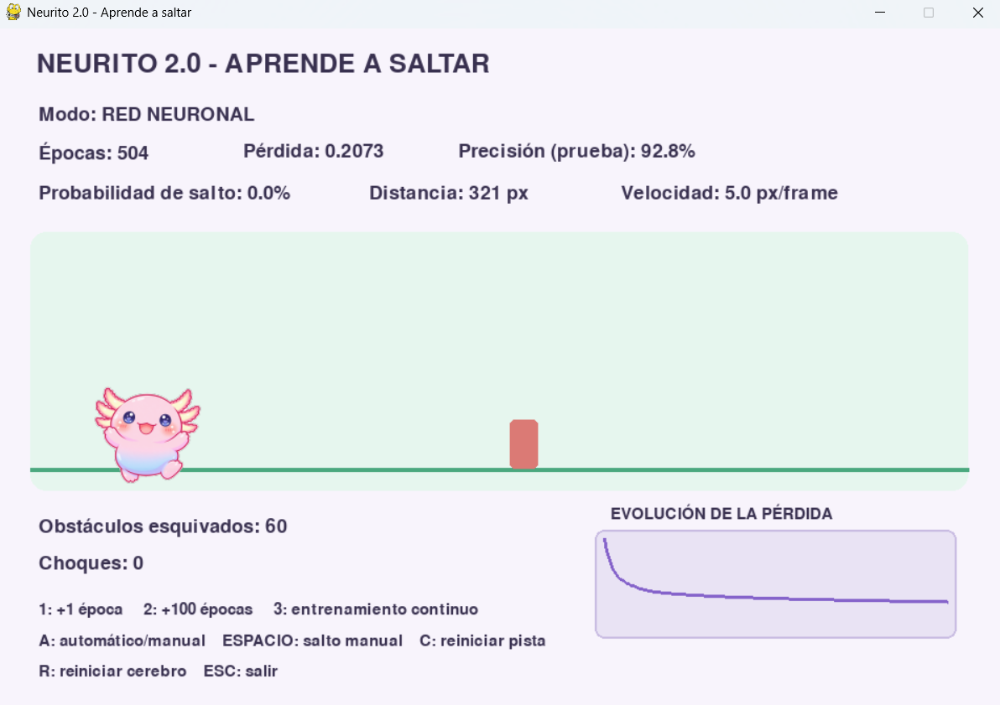
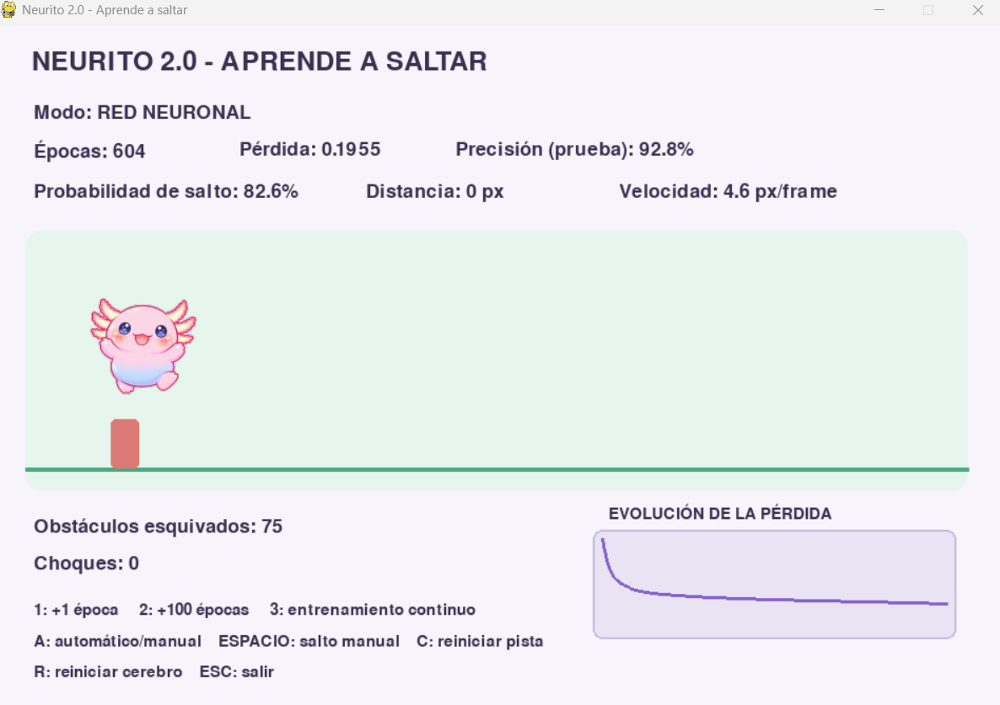

# Neurito – My Artificial Brain

## Experimentos

### 1. Prueba el juego sin entrenar

Al probar el juego sin entrenar, sin cambiar ningún valor, Neurito se choca contra el obstáculo todo el tiempo y no esquiva ninguno. Esto pasa porque no tiene ningún ciclo de aprendizaje, es decir, ninguna época, entonces todavía no sabe cuándo debe saltar.

---

### 2. Entrena de cien en cien épocas

**100 épocas.** La precisión fue de 91,2 %. La gráfica de la pérdida baja rápido al principio y después se estabiliza. Neurito ya salta bastante bien, aunque en algunas ocasiones se equivoca y choca.

**200 épocas.** La gráfica de la pérdida se ve casi igual que con 100 épocas, con un cambio leve. La precisión subió un poco, a 91,9 %. El comportamiento es parecido, pero se ve mucho menos que Neurito se estrelle.

**300 épocas.** La gráfica sigue viéndose muy parecida. La precisión subió ligeramente a 92,4 %. Sigue saltando el obstáculo con éxito y muy rara vez se estrella.

**400 épocas.** La gráfica no muestra ningún cambio notable. La precisión es de 92,7 %, un cambio muy pequeño. El comportamiento ya es casi perfecto, y solo en ocasiones muy raras no alcanza a saltar el obstáculo.

**500 épocas.** La gráfica se ve igual que en las demás pruebas. La precisión es de 92,8 %, otra vez un aumento pequeño. El comportamiento es prácticamente perfecto: para ver que falle un salto habría que esperar a que esquive muchísimos obstáculos, y eso es poco probable.

**600 épocas.** La gráfica sigue sin mostrar un cambio grande y la precisión fue de 92,8 %, igual que con 500. El comportamiento es muy parecido al anterior: salta casi perfecto y verlo fallar sería algo fuera de lo común.

| Épocas | Pérdida | Precisión |
|---|---|---|
| 100 | 0,2601 | 91,2 % |
| 200 | 0,2416 | 91,9 % |
| 300 | 0,2265 | 92,4 % |
| 400 | 0,2164 | 92,7 % |
| 500 | 0,2073 | 92,8 % |
| 600 | 0,1955 | 92,8 % |

**Conclusión.** Lo que más se aprende es al principio: de 0 a 100 épocas la precisión pasa de 44,9 % a 91,2 %. Después, cada 100 épocas más la precisión sube muy poco. Al principio parece que aumentar de 100 en 100 épocas siempre sube la precisión, pero no es del todo cierto, porque entre 500 y 600 se quedó en el mismo valor. La gráfica se ve casi plana a simple vista, pero si se miran los números la pérdida sí va bajando poco a poco (de 0,26 a 0,19).

---

### 3. Cambia `ocultas=12` por `ocultas=3` o `ocultas=24`

Se probó cambiando solo el número de neuronas ocultas, entrenando 600 épocas (promedio de varias pruebas):

| Neuronas ocultas | Precisión | Comportamiento |
|---|---|---|
| 3 | 85,5 % | Choca bastante y a veces no aprende a saltar |
| 12 | 94,4 % | Salta bien, casi no choca |
| 24 | 97,2 % | Salta perfecto, no choca |

Con **3 neuronas** Neurito aprende peor. Es la que más choca y los resultados cambian mucho de una prueba a otra: unas veces funciona y otras casi no aprende. Tiene muy pocas neuronas para aprender lo que necesita.

Con **12 neuronas** funciona bien, pero necesita más épocas para llegar tan lejos como la de 24.

Con **24 neuronas** aprende más rápido, tiene la mejor precisión y casi no cambia entre una prueba y otra.

**Generalización.** En los tres casos la precisión con los datos de prueba (datos nuevos) fue casi igual a la de los datos de entrenamiento. Eso quiere decir que Neurito no está memorizando, sino que sí aprendió la regla. La diferencia entre tener 3, 12 o 24 neuronas no es que unas generalicen peor, sino que con más neuronas la red logra aprender mejor.

**Conclusión.** Más neuronas ocultas dan mejor precisión y un comportamiento más estable. Con 3 no alcanza, con 12 es suficiente y con 24 aprende más rápido.

---

### 4. Modifica la tasa de aprendizaje `0.8` a `0.01` o `1.2`

Se probó con 12 neuronas ocultas (promedio de varias pruebas):

| Tasa | Precisión (100 épocas) | Precisión (600 épocas) | Comportamiento |
|---|---|---|---|
| 0,01 | 80,3 % | 84,9 % | No salta, choca todo el tiempo |
| 0,8 | 91,5 % | 94,4 % | Salta bien desde las primeras épocas |
| 1,2 | 91,5 % | 95,1 % | Salta bien, pero al principio a veces falla |

Con **0,01** aprende muy lento. La pérdida baja poco a poco, pero incluso después de 600 épocas Neurito todavía no salta y se choca contra todos los obstáculos. Aunque la precisión parece decente (84,9 %), eso no alcanza para que Neurito juegue bien.

Con **0,8** aprende rápido: con solo 100 épocas ya salta casi siempre y la pérdida baja de forma bastante estable.

Con **1,2** también aprende rápido y al final llega un poco más lejos (con 2.000 épocas llegó a 99,1 %, contra 97,3 % de la de 0,8). Lo malo es que la pérdida sube y baja más, y con pocas épocas todavía puede fallar: con 100 épocas en algunas pruebas Neurito aún no saltaba.

**Conclusión.** Una tasa muy baja (0,01) hace que aprenda demasiado lento. Una tasa alta como 1,2 aprende rápido, pero de forma menos estable. En este juego tanto 0,8 como 1,2 funcionan bien, y 1,2 termina un poco mejor.