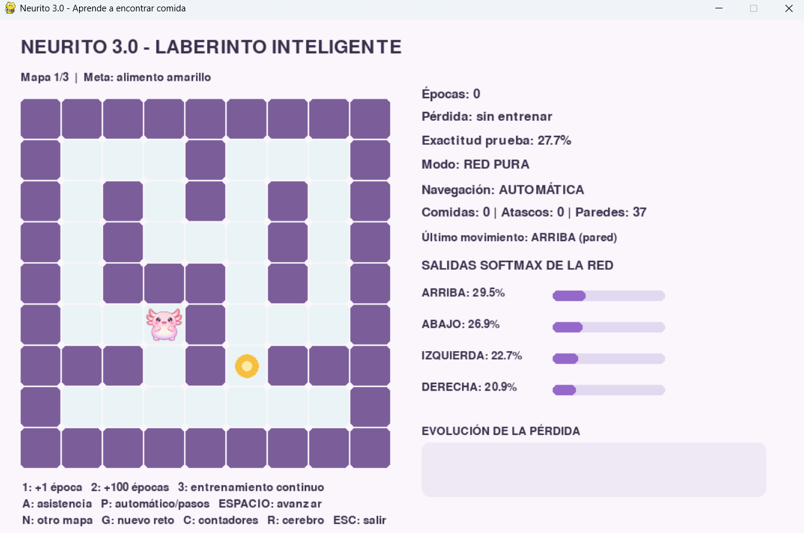
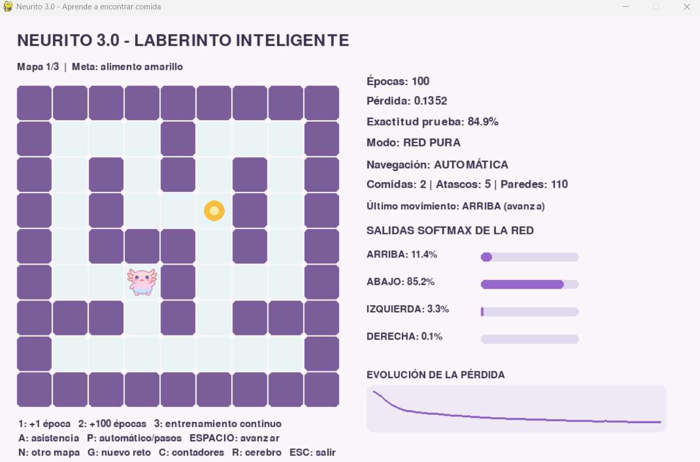
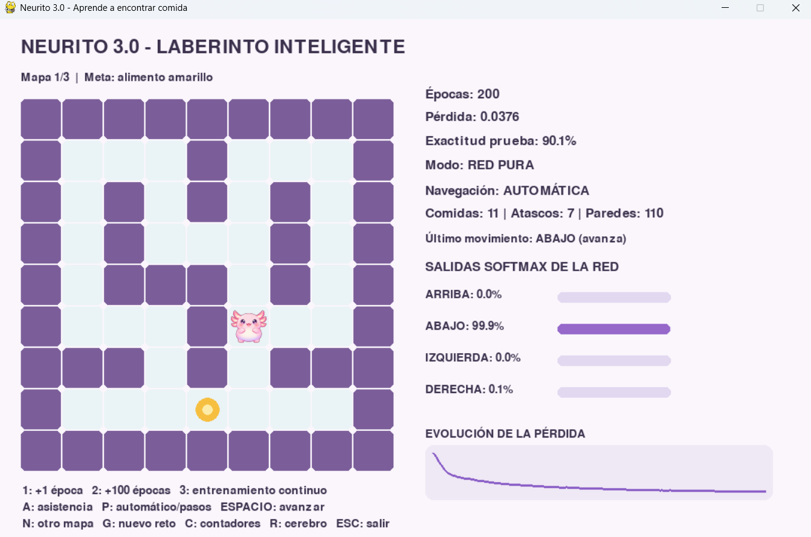
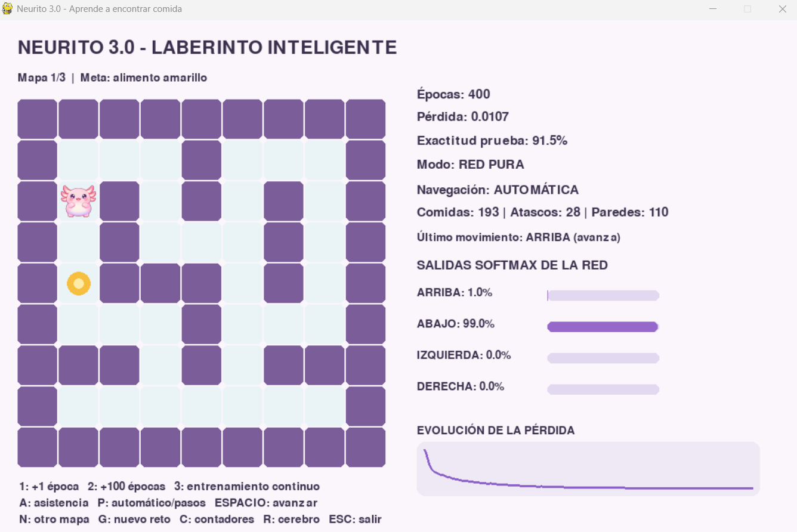
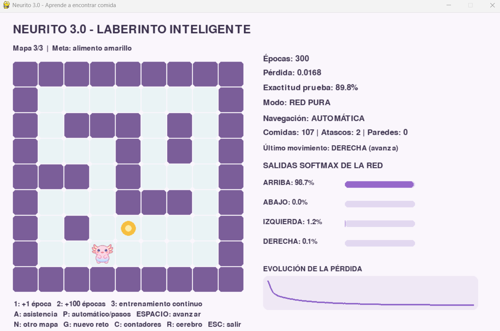
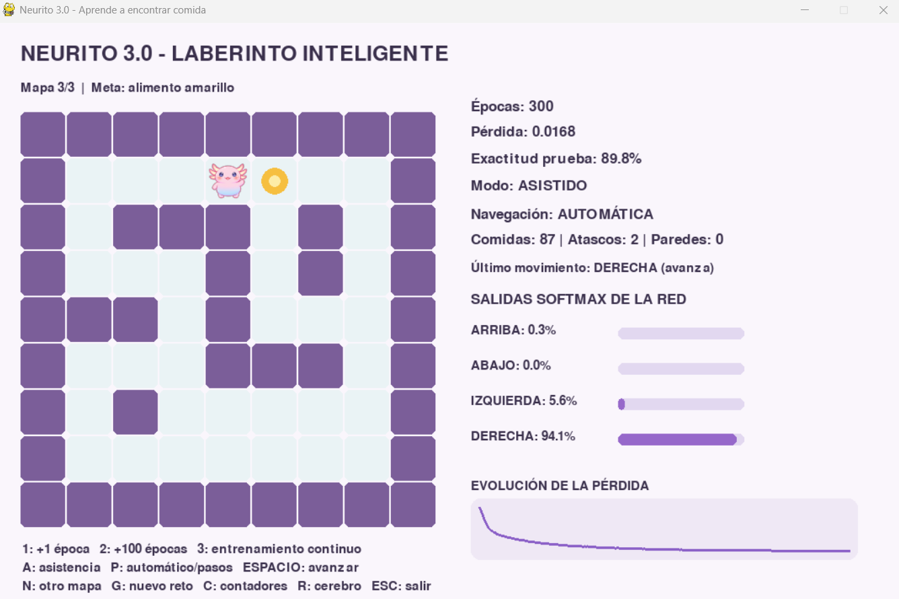
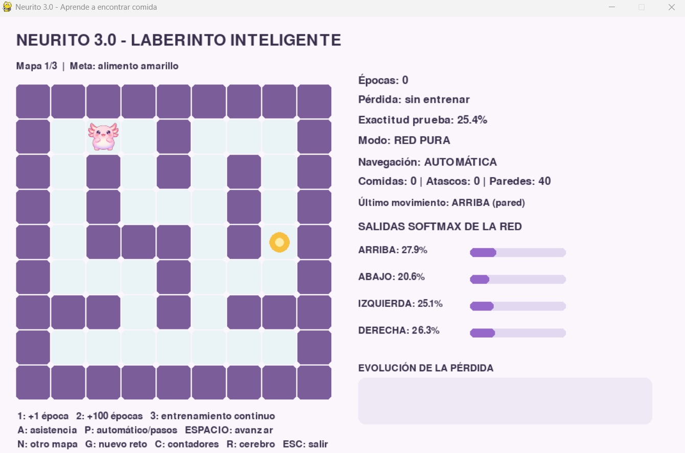
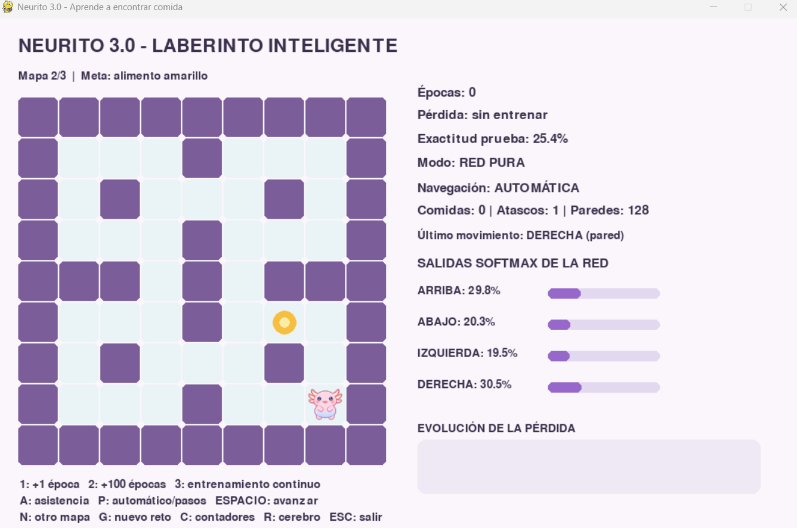
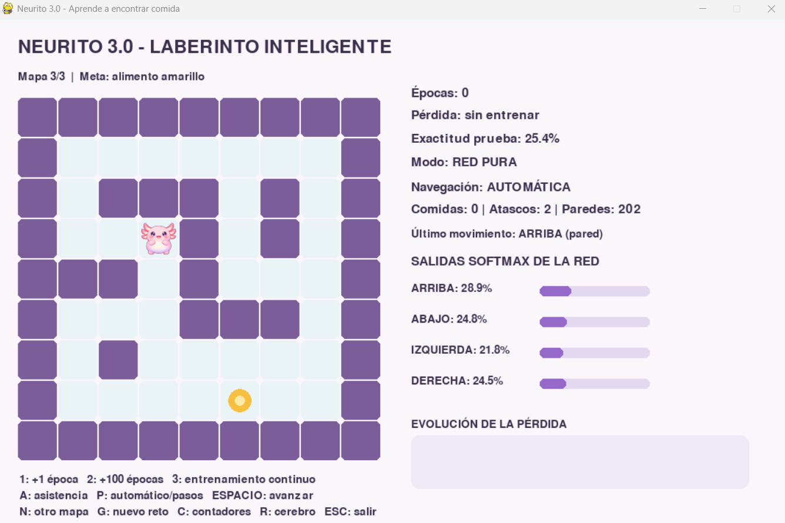

# Laboratorio de Neurito

## 1. Neurito sin entrenar



Al empezar, la red tiene pesos aleatorios. Todavía no sabe qué movimiento
acerca a Neurito a la comida. Por eso puede escoger una dirección equivocada,
chocar con una pared o repetir el mismo movimiento. Eso es lo que hace que se
atasque.

## 2. Entrenamiento







Estos fueron los resultados:

| Épocas | Pérdida | Precisión | Éxito red pura | Éxito asistido |
|---:|---:|---:|---:|---:|
| 100 | 0.1220 | 85.2% | 85.3% | 98.7% |
| 200 | 0.0366 | 89.2% | 85.3% | 98.7% |
| 400 | 0.0103 | 90.8% | 85.3% | 98.7% |

Al entrenar más, la pérdida baja y la precisión sube. La red aprende a imitar
las decisiones de BFS. La precisión no es exactamente lo mismo que resolver el
laberinto, porque una sola decisión equivocada puede cambiar el recorrido.

## 3. Red pura y navegación asistida





La red recibe el mapa, la posición actual y la meta. Después calcula cuatro
probabilidades y elige un movimiento.

La asistencia es código con reglas: no permite ir contra una pared y
penaliza las casillas que ya se visitaron. No es algo que la red haya
aprendido. Es una ayuda que se aplica después de la predicción.

Por eso la red pura puede chocar o repetir movimientos, mientras que la
asistida corrige parte de esos errores.

## 4. Cambiar el número de neuronas

El programa quedó preparado para cambiar este valor en laberinto.py:

```python
NEURONAS_OCULTAS = 128
```

Probé distintos tamaños durante 400 épocas:

| Neuronas | Pérdida | Precisión | Éxito asistido |
|---:|---:|---:|---:|
| 16 | 0.0342 | 87.2% | 99.0% |
| 32 | 0.0161 | 89.2% | 98.3% |
| 96 | 0.0107 | 91.5% | 99.6% |
| 128 | 0.0103 | 90.8% | 98.7% |

Con 16 neuronas cuesta más aprender. Con 32 y 96 mejora el resultado. En esta
prueba, 96 tuvo la mejor precisión, aunque 128 terminó con una pérdida un poco
menor. Poner más neuronas no siempre significa resolver más laberintos.

## 5. Tasa de aprendizaje

También quedó visible en laberinto.py:

```python
TASA_APRENDIZAJE = 0.45
```

Con 0.45 la red sí converge. Después de 400 épocas obtuvo una pérdida de
0.0103 y una precisión de 90.8%. La pérdida fue bajando, así que no se observó
divergencia en esta prueba.

## 6. Cambiar de mapa







Los tres mapas se usan para entrenar. Lo que cambia en la prueba son las
combinaciones de inicio y meta. Es decir, Neurito ve los mapas, pero no
necesariamente ha visto antes ese recorrido concreto.

Con 400 épocas y asistencia:

- Mapa 1: 99.5% de éxito.
- Mapa 2: 97.2% de éxito.
- Mapa 3: 99.6% de éxito.

Esto demuestra que la red generaliza a posiciones y metas nuevas, pero no
prueba todavía un mapa completamente desconocido.

## 7. Vibecoding: cambiar DFS por BFS y A*

La comparación se puede ejecutar con el archivo
[`vibecoding_laberinto.py`](vibecoding_laberinto.py):

```powershell
uv run vibecoding_laberinto.py
```

El programa prueba los tres algoritmos con los mismos
mapas y los mismos retos:

| Algoritmo | Éxito | Movimientos promedio | Celdas revisadas |
|---|---:|---:|---:|
| DFS | 100.0% | 10.7 | 18.6 |
| BFS | 100.0% | 6.1 | 18.5 |
| A* | 100.0% | 6.1 | 10.3 |

**DFS** busca siguiendo un camino hasta el fondo antes de probar otras
opciones. Encuentra la comida, pero puede meterse por un camino largo y tener
que volver. Por eso necesitó 10.7 movimientos de media.

**BFS** revisa primero las posiciones más cercanas al inicio. En este laberinto
todos los movimientos cuestan lo mismo, así que encuentra una ruta mínima. Bajó
el recorrido a 6.1 movimientos.

**A*** también encontró rutas de 6.1 movimientos, pero revisó menos celdas. La
razón es que usa una estimación de la distancia que falta hasta la meta y
prioriza las posiciones que parecen más prometedoras.

En resumen, cambiar DFS por BFS mejora bastante la longitud del camino.
Cambiar BFS por A* no hizo el camino más corto en esta prueba, porque BFS ya
encontraba el mínimo, pero sí hizo más eficiente la búsqueda. DFS funciona,
pero es el peor de los tres para este caso.

Estos tres algoritmos conocen el mapa y funcionan como reglas de navegación.
No son aprendizaje de la red. La red intenta imitar las decisiones de BFS;
DFS, BFS y A* sirven para comparar qué estrategia de búsqueda conviene más.
